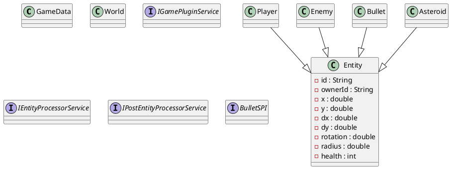
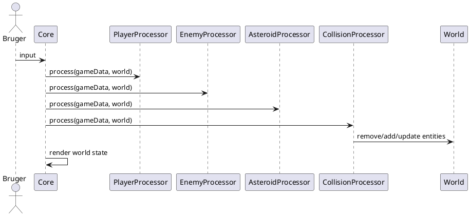

# SB-KOM Rapportudkast

Student Name: `INDSÆT NAVN`  
Student Exam number: `INDSÆT EKSAMENSNUMMER`  
GitHub User: `INDSÆT GITHUB-BRUGER`  
GitHub Repo: `INDSÆT REPOSITORY-LINK`  

## Abstract
Denne rapport beskriver udviklingen af et komponentbaseret Asteroids-spil implementeret i Java som et modulært multi-module projekt. Rapportens hovedproblem er, hvordan et spil kan struktureres, så centrale gameplay-funktioner som spillerstyring, fjender, skud, asteroider, kollisionsbehandling og rendering ikke implementeres som en monolitisk applikation, men som selvstændige komponenter med eksplicitte kontrakter og tydelige afhængigheder. Problemstillingen er relevant i en CBSE-kontekst, fordi komponentbaseret softwareudvikling netop har til formål at forbedre modularitet, udskiftelighed og vedligeholdbarhed gennem klare grænseflader og kontrolleret sammensætning [1], [2].

Den udviklede løsning anvender Java Platform Module System (JPMS), `ServiceLoader` og `ModuleLayer` til at sammensætte spillet af løst koblede moduler. `Core` fungerer som fælles runtime-miljø og indeholder game loop, fælles data, rendering, start- og reset-kontrol, scorevisning, levelsystem og health bar. Modulerne `Player`, `Bullet`, `Asteroids`, `Enemy` og `Collision` bidrager hver med afgrænset funktionalitet gennem service-baserede kontrakter. Særligt `Enemy`-modulet er placeret som et eksternt plugin i mappen `plugins/`, hvilket demonstrerer installation og afinstallation uden rekompilering af `Core`.

Resultatet er et fungerende Asteroids-spil, der både opfylder de centrale gameplay-krav og demonstrerer væsentlige CBSE-principper som høj kohæsion, løs kobling, eksplicitte kontrakter, stærk indkapsling og runtime-komposition. Systemet er desuden valideret gennem Maven-build, automatiserede tests og en eksperimentel plugin-demonstration, hvor fjendekomponenten kan fjernes og genindsættes uden ændringer i kerneapplikationen.

## Introduction
Projektet omhandler udviklingen af et 2D Asteroids-spil, hvor spilleren styrer et rumskib, der kan rotere, bevæge sig og affyre projektiler. Samtidig bevæger asteroider sig rundt på skærmen, og en fjendekomponent introducerer yderligere pres ved at bevæge sig og skyde mod spilleren. Spillet indeholder score, level-progression, health-regeneration samt en brugergrænseflade med startknap og resetknap ved game over. På overfladen er der således tale om et klassisk arkadespil, men projektets egentlige formål er at demonstrere komponentbaseret softwareudvikling i praksis.

I en traditionel monolitisk spilapplikation vil logik, rendering, inputhåndtering og spilelementer ofte være tæt koblet. Det gør systemet vanskeligere at udvide, teste og modificere. I dette projekt er målet derfor at undersøge, hvordan et spil kan designes som et sæt samarbejdende komponenter, hvor hver komponent leverer en afgrænset service og kun afhænger af veldefinerede kontrakter. På den måde bliver det muligt at udskifte eller tilføje funktionalitet uden at genkompilere hele systemet, hvilket er et centralt mål i CBSE [1], [3].

Den valgte tekniske tilgang bygger på JPMS til modulær struktur, `ServiceLoader` til serviceopdagelse og `ModuleLayer` til dynamisk plugin-loading. Disse teknologier gør det muligt at håndhæve stærk indkapsling og på samme tid understøtte fleksibel runtime-sammensætning [4], [5]. Projektets problemformulering kan derfor sammenfattes således:

**Hvordan kan et Asteroids-spil designes og implementeres som et komponentbaseret, modulært system, hvor centrale gameplay-komponenter kan registreres, anvendes, installeres og fjernes gennem veldefinerede kontrakter uden recompilation af kerneapplikationen?**

## Requirements
### Funktionelle krav
Systemet skal opfylde følgende funktionelle krav:

1. Spillet skal indeholde komponenterne `Player`, `Enemy`, `Asteroids`, `Bullet/Weapon`, `Collision` og `Core/Rendering`.
2. Spilleren skal kunne bevæge sig, rotere og skyde.
3. Asteroider skal kunne bevæge sig, kollidere og splittes i mindre enheder.
4. Fjenden skal kunne optræde som en separat komponent, bevæge sig og affyre skud.
5. Kollisioner mellem spillere, fjender, asteroider og projektiler skal håndteres korrekt.
6. Spillet skal understøtte score, level-progression og health-mekanik.
7. Systemet skal kunne startes gennem en startknap og nulstilles efter game over gennem en resetknap.
8. Fjendekomponenten skal kunne fjernes og tilføjes igen uden rekompilering af `Core`.
9. Komponenter skal kunne registreres og tilgås gennem services frem for direkte instansiering.

### Ikke-funktionelle krav
Ud over de funktionelle krav skal følgende ikke-funktionelle krav opfyldes:

1. Systemet skal være modulært og eksplicit opdelt i komponenter.
2. Afhængigheder mellem moduler skal være deklareret og kontrolleret gennem JPMS.
3. Komponenterne skal være løst koblede og have høj intern kohæsion.
4. Løsningen skal være testbar gennem enhedstest og praktisk verifikation.
5. Kerneapplikationen må ikke kende konkrete implementationer af gameplay-komponenter på forhånd.
6. Projektet skal understøtte dynamisk installation og afinstallation af mindst én komponent gennem et plugin-scenarie.

### Krav om dynamisk komponentinstallation
Et centralt krav i projektet er, at Player-, Enemy- og Weapon/Bullet-relaterede funktioner skal være komponentbaserede og dermed kunne udskiftes eller opdateres uden recompilation af rendering/core. I denne løsning demonstreres dette tydeligst gennem `Enemy`-komponenten, som kan fjernes fra `plugins/` og derefter ikke længere indgå i systemets runtime-sammensætning. Denne mekanisme fungerer uden ændringer i `Core`, hvilket opfylder kravet om dynamisk plugin-understøttelse.

### Krav om løs kobling og testbarhed
For at sikre løs kobling må komponenterne ikke være afhængige af konkrete klasser fra andre gameplay-moduler, medmindre disse er eksponeret gennem eksplicitte kontrakter. Testbarhed kræver desuden, at central logik som collision-behandling, movement og progression kan verificeres isoleret. Dette krav er opfyldt gennem tests af player movement, collision-behandling og score/level-progression.

## Analysis
Analyseafsnittet beskriver, hvad systemet skal kunne, uden at fokusere på den konkrete kode.

### Use cases
Følgende use cases beskriver de vigtigste funktioner i systemet:

#### Use case 1: Start spil
- **Aktør:** Bruger
- **Forløb:** Brugeren starter programmet og trykker på startknappen.
- **Resultat:** Systemet initialiserer en ny spilsession og opretter de nødvendige entiteter gennem registrerede plugin-services.

#### Use case 2: Spil en runde
- **Aktør:** Bruger
- **Forløb:** Brugeren styrer spilleren, skyder mod asteroider og forsøger at overleve fjendens skud.
- **Resultat:** Score og levels opdateres løbende, og verdenens entiteter ændres over tid.

#### Use case 3: Game over og reset
- **Aktør:** Bruger
- **Forløb:** Spilleren mister al health og dør.
- **Resultat:** Systemet stopper den aktive session, viser game over-tekst og gør det muligt at starte en ny runde via resetknappen.

#### Use case 4: Fjern plugin uden recompilation
- **Aktør:** Udvikler/demonstrator
- **Forløb:** `Enemy`-pluginet fjernes fra `plugins/`, hvorefter spillet startes igen.
- **Resultat:** Spillet fungerer stadig, men uden fjendekomponenten.

### Gameplay flow
På et overordnet niveau fungerer gameplayet som følger:

1. Brugeren starter programmet.
2. `Core` opretter først brugergrænsefladen, men starter ikke gameplayet før brugeren trykker `Start`.
3. Ved start oprettes entiteter gennem registrerede `IGamePluginService`-implementationer.
4. Hver frame udfører systemet først `IEntityProcessorService`-services og derefter `IPostEntityProcessorService`.
5. Kollisioner kan fjerne, oprette eller opdatere entiteter.
6. Spillet tegnes på ny ud fra den aktuelle tilstand i `World`.
7. Ved død eller sejr opdateres brugergrænsefladen tilsvarende.

### Rough draft af interfaces og entiteter
Den tidlige analyse peger på fire centrale kontrakter:

- `IGamePluginService`
- `IEntityProcessorService`
- `IPostEntityProcessorService`
- `BulletSPI`

Disse kontrakter er nødvendige for at kunne opdele ansvaret mellem komponenter. Tilsvarende kræver systemet en fælles datastruktur for entiteter og world state. Derfor identificeres følgende centrale domæneobjekter:

- `GameData`
- `World`
- `Entity`
- `Player`
- `Enemy`
- `Bullet`
- `Asteroid`

### Analyse af komponenter og ansvarsfordeling
En væsentlig del af analysen er at afgøre, hvilke ansvar der bør placeres i hvilke komponenter.

- `Core` skal have ansvar for applikationsopstart, game loop, rendering og samlet runtime-koordination.
- `Player` skal have ansvar for spilleroprettelse og input-baseret bevægelse.
- `Bullet` skal have ansvar for projektiloprettelse og projektilopdatering.
- `Asteroids` skal have ansvar for generering, bevægelse og difficulty scaling af asteroider.
- `Enemy` skal have ansvar for fjendeadfærd og fungere som udskifteligt plugin.
- `Collision` skal have ansvar for tværgående kollisionsregler og efterbehandling.

Denne ansvarsfordeling reducerer systemets kobling, fordi hver komponent primært fokuserer på ét funktionelt område.

## Design
Designet konkretiserer analysen ved at fastlægge struktur, kontrakter og forbindelser mellem systemets komponenter.

### Component-based architecture
Systemet er designet som en komponentbaseret arkitektur med `Core` som fælles runtime og de øvrige moduler som samarbejdende services. Designet følger CBSE-principperne ved at lade komponenter kommunikere gennem interfaces i stedet for direkte klasseafhængigheder [1], [2].

### Beskrivelse af centrale komponenter
#### Core
`Core` indeholder:

- JavaFX-applikationen
- game loop
- fælles datatyper (`GameData`, `World`, `Entity`)
- rendering
- HUD, score, health bar, startknap og resetknap
- servicekontrakterne der bruges af resten af systemet

`Core` er bevidst gjort ansvarlig for den samlede runtime-kontekst, men ikke for konkret gameplay-adfærd.

#### Player
`Player` leverer:

- en `IGamePluginService`, som opretter spilleren
- en `IEntityProcessorService`, som opdaterer spillerens rotation, bevægelse og skud

`Player` afhænger af `BulletSPI`, men kender ikke selve bullet-implementeringen.

#### Bullet
`Bullet` leverer:

- en plugin-service
- en entity-processor
- en implementation af `BulletSPI`

Komponenten er dermed ansvarlig for både at oprette projektiler og opdatere dem over tid.

#### Enemy
`Enemy` leverer:

- en plugin-service
- en entity-processor

Designmæssigt er `Enemy` speciel, fordi den bruges som demonstrator for ekstern plugin-loading via `plugins/` og `ModuleLayer`.

#### Asteroids
`Asteroids` leverer:

- oprettelse af initiale asteroider
- bevægelse af asteroider
- level-baseret skalering af sværhedsgrad

#### Collision
`Collision` leverer:

- post-frame kollisionsbehandling
- splitting af store asteroider
- skade på spiller og fjende
- score-opdatering ved asteroid-destruktion

### JPMS module structure
Den modulære struktur er:

- `Core`
- `Player`
- `Bullet`
- `Enemy`
- `Asteroids`
- `Collision`

Hvert modul deklarerer sine afhængigheder i `module-info.java`. Dette gør designet eksplicit og reducerer skjulte koblinger [4], [5].

### ServiceLoader flow
Designet for service-loading er:

1. `Core` loader boot-layer services med `ServiceLoader`.
2. `Core` scanner `plugins/`.
3. Hvis der findes plugin-moduler, oprettes en separat `ModuleLayer`.
4. `Core` loader herefter også services fra denne plugin-layer.

Dette design betyder, at systemets sammensætning afgøres ved runtime, ikke kun ved compile time.

### ModuleLayer og plugin-loading
`ModuleLayer` bruges til at isolere plugin-moduler fra boot-laget og samtidig gøre dem tilgængelige for `ServiceLoader`. Dette valg er centralt i designet, fordi det løser split-package-/plugin-scenariet fra JPMS-labs og samtidigt giver en konkret demonstration af dynamisk systemassembly [5], [6].

### Provided/required interfaces
Designet anvender både provided og required interfaces:

- `Player`, `Bullet`, `Asteroids`, `Enemy` og `Collision` **provides** services
- `Core` **uses** serviceinterfaces
- `Player` og `Enemy` **uses** `BulletSPI`
- `Bullet` **provides** `BulletSPI`

Det giver løs kobling, fordi en komponent ikke behøver kende den konkrete implementation bag et interface.

### Loose coupling og high cohesion
Designet understøtter løs kobling ved:

- at placere fælles kontrakter i `Core`
- at lade komponenter arbejde gennem serviceinterfaces
- at begrænse modulafhængigheder til det nødvendige

Designet understøtter høj kohæsion ved:

- at hver gameplay-komponent har et klart funktionelt ansvar
- at kollisionslogik er samlet ét sted
- at rendering og runtime-koordination er samlet i `Core`

## UML
### UML class diagram
Følgende PlantUML beskriver den overordnede klassemodel:



### UML component diagram
Følgende PlantUML beskriver komponentrelationerne:

```plantuml
@startuml
package Core {
  [Core]
  interface IGamePluginService
  interface IEntityProcessorService
  interface IPostEntityProcessorService
  interface BulletSPI
}

[Player] ..> BulletSPI : uses
[Enemy] ..> BulletSPI : uses
[Bullet] ..> BulletSPI : provides

[Player] ..> IGamePluginService : provides
[Player] ..> IEntityProcessorService : provides
[Bullet] ..> IGamePluginService : provides
[Bullet] ..> IEntityProcessorService : provides
[Asteroids] ..> IGamePluginService : provides
[Asteroids] ..> IEntityProcessorService : provides
[Enemy] ..> IGamePluginService : provides
[Enemy] ..> IEntityProcessorService : provides
[Collision] ..> IPostEntityProcessorService : provides

[Core] ..> IGamePluginService : uses
[Core] ..> IEntityProcessorService : uses
[Core] ..> IPostEntityProcessorService : uses
@enduml
```

### Sequence diagram
Følgende PlantUML beskriver et typisk frame-forløb:



Disse diagrammer kan bruges direkte som PlantUML eller omsættes til grafiske figurer i et separat værktøj før aflevering.

## Contracts
### `IGamePluginService.start(GameData, World)`
**Preconditions**
- `GameData` og `World` er initialiserede.
- Komponentens modul er registreret og tilgængeligt via service-loaderen.
- Komponenten er ikke allerede startet i den aktuelle session.

**Postconditions**
- Komponenten har oprettet sine initiale entiteter i `World`.
- Entiteterne er i en gyldig tilstand med id, position og eventuelle nødvendige attributter sat.

### `IGamePluginService.stop(GameData, World)`
**Preconditions**
- Komponenten har tidligere været startet.
- `World` indeholder eventuelt entiteter ejet af komponenten.

**Postconditions**
- Komponentens egne entiteter er fjernet eller gjort inaktive.
- `World` indeholder ikke resterende runtime-tilstand, der tilhører komponenten.

### `IEntityProcessorService.process(GameData, World)`
**Preconditions**
- Der er tale om en gyldig frame-opdatering.
- `GameData` indeholder aktuel delta-tid.
- Relevante entiteter findes i `World`.

**Postconditions**
- Komponentens entiteter er opdateret i henhold til deres adfærd.
- Tilstanden i `World` er konsistent efter opdateringen.

### `IPostEntityProcessorService.process(GameData, World)`
**Preconditions**
- Alle almindelige entity-processorer har gennemført frame-opdateringen.
- `World` indeholder den aktuelle mængde entiteter for framen.

**Postconditions**
- Kollisioner og anden efterbehandling er udført.
- Entiteter kan være fjernet, delt eller ændret som følge af reglerne.

### Kontrakt for collision handling
**Preconditions**
- De involverede entiteter har position og radius.
- Kollisionsreglerne anvendes først efter movement/process-steps.

**Postconditions**
- Projektiler fjernes korrekt ved hit.
- Små asteroider fjernes.
- Store asteroider deles i to mindre.
- Health og score opdateres i overensstemmelse med spillereglerne.

### Kontrakt for bullet movement
**Preconditions**
- Kuglen er oprettet gennem `BulletSPI`.
- Kuglen har initial position og bevægelsesretning.

**Postconditions**
- Kuglen flyttes i henhold til sin hastighed og delta-tid.
- Kuglen fjernes, hvis den forlader skærmområdet.

### Kontrakt for plugin loading
**Preconditions**
- `plugins/` findes eller kan mangle uden at systemet fejler.
- Plugin-modulet er bygget som gyldigt JPMS-modul.

**Postconditions**
- Hvis modulet findes og kan resolves, bliver det tilgængeligt i plugin-layeren.
- Hvis modulet ikke findes, fortsætter systemet uden plugin-funktionaliteten.

## Implementation
### JPMS og `module-info.java`
Alle moduler i projektet er defineret som JPMS-moduler og indeholder en `module-info.java`. Dette gør det muligt at deklarere præcise afhængigheder og samtidig eksplicit styre, hvilke pakker der eksporteres [4], [5]. `Core` eksporterer fælles data og serviceinterfaces, mens implementationsmodulerne typisk eksporterer deres egne pakkestrukturer og registrerer services gennem `provides`.

### `uses` og `provides`
Komponentregistreringen er implementeret gennem JPMS service-syntax:

- `Core` anvender `uses` for at erklære, at det forventer implementationer af serviceinterfaces.
- Gameplay-moduler anvender `provides ... with` for at registrere konkrete implementationer.

Denne mekanisme gør det muligt at opnå runtime-sammensætning uden hårde compile-time-afhængigheder mellem `Core` og konkrete gameplay-komponenter.

### `ServiceLoader`
`ServiceLoader` bruges i `Core` til at hente de registrerede services ved runtime [7]. I praksis betyder det, at `Core` kan starte plugins, køre entity-processorer og udføre post-processorer uden at kende de konkrete klasser på forhånd. Dette er et centralt CBSE-træk, fordi kerneapplikationen arbejder mod kontrakter og ikke mod specifikke implementationer.

### `ModuleLayer`
`ModuleLayer` bruges til at oprette et separat runtime-lag for eksterne plugins. `Core` scanner mappen `plugins/`, opbygger en `ModuleFinder`, resolver modulerne og opretter derefter et nyt modul-lag. Herefter kan `ServiceLoader` loade services både fra boot-laget og plugin-laget. Denne teknik er særlig relevant i JPMS-sammenhæng, fordi den gør det muligt at håndtere eksterne moduler struktureret og kontrolleret [5], [6].

### `plugins/`
Mappen `plugins/` fungerer som installationspunkt for eksterne moduler. I den nuværende løsning er `Enemy`-modulet kopieret dertil under build-processen. Ved at fjerne eller omdøbe `plugins/Enemy-1.0-SNAPSHOT.jar` kan systemet startes uden fjendekomponenten. Når filen gendannes, bliver komponenten igen en del af systemet ved næste start. Dermed demonstreres komponentinstallation og -afinstallation uden recompilation af `Core`.

### Hvorfor `Enemy` er ekstern plugin
`Enemy` er valgt som ekstern plugin, fordi det giver en tydelig og let demonstrerbar komponentgrænse. Fjenden er gameplay-mæssigt selvstændig, men ikke kritisk for at `Core` eller de øvrige moduler kan fungere. Derfor er `Enemy` velegnet som eksempel på, at systemets samlede funktionalitet kan ændres gennem udskiftning af komponenter frem for gennem ændringer i kernekoden.

### Installering og fjernelse uden recompilation
Følgende fremgangsmåde demonstrerer installation og afinstallation:

1. Kør `mvn clean test package`
2. Kontrollér at `plugins/Enemy-1.0-SNAPSHOT.jar` findes
3. Start spillet med `sh run-game.sh`
4. Luk spillet
5. Omdøb plugin-filen i `plugins/`
6. Start spillet igen uden ny kompilering
7. Observer at fjenden er væk
8. Gendan plugin-filen og start igen

Denne sekvens viser, at `Core` ikke skal genbygges for at tilpasse systemets sammensætning.

### Stærk indkapsling og pålidelige afhængigheder
JPMS bidrager til stærk indkapsling ved kun at tillade adgang til de pakker, der eksplicit eksporteres. Samtidig gør `requires`-deklarationerne afhængighederne gennemsigtige og pålidelige. Dette reducerer risikoen for skjulte koblinger og gør arkitekturen lettere at analysere og vedligeholde [4].

## Test
### Unit tests
Projektet indeholder automatiserede enhedstests, der fokuserer på centrale gameplay-mekanismer:

- player movement
- collision handling
- score- og level-progression

Disse tests er valgt, fordi de repræsenterer kritiske og relativt deterministiske dele af systemets logik. Dermed kan fejl i centrale komponentkontrakter identificeres uden at skulle afvikle hele spillet manuelt.

### Integration-orienteret verifikation
Selv om der ikke findes store integrationstests i traditionel forstand, er systemet valideret som samlet applikation gennem build og runtime-kørsel. Følgende kommando blev brugt:

```bash
mvn clean test package
```

Denne kommando validerer:

- at alle moduler kan kompileres samlet
- at service- og modulafhængigheder resolves korrekt
- at tests gennemføres uden fejl
- at artefakter kopieres korrekt til `mods-mvn/` og `plugins/`

### Collision tests
Collision-testene verificerer blandt andet:

- at store asteroider deles korrekt ved hit
- at små asteroider forsvinder
- at skibets health reduceres ved fjendeskud
- at score og level-state opdateres korrekt ved asteroid-destruktion

Disse tests er vigtige, fordi collision-komponenten repræsenterer tværgående logik mellem flere moduler.

### Score- og level-tests
Score og level-progression er testet for at sikre, at:

- ødelæggelse af asteroider giver point
- level stiger efter det definerede antal ødelagte asteroider
- sluttilstanden for level-progression fungerer konsistent

### Plugin-verifikation
Dynamisk plugin-adfærd blev verificeret gennem en eksperimentel procedure:

```bash
mv plugins/Enemy-1.0-SNAPSHOT.jar plugins/Enemy-1.0-SNAPSHOT.jar.off
sh run-game.sh
mv plugins/Enemy-1.0-SNAPSHOT.jar.off plugins/Enemy-1.0-SNAPSHOT.jar
sh run-game.sh
```

Denne test viser, at systemet fortsætter med at fungere uden fjenden, og at fjenden igen er tilgængelig, når plugin-filen gendannes. Dette er en praktisk demonstration af dynamiske opdateringer i en reel runtime-sammenhæng.

### Begrænsninger i teststrategien
Teststrategien har styrker, men også begrænsninger. Den dækker centrale logiske mekanismer, men ikke alle mulige gameplay-scenarier. Brugeroplevelse, balance og realtime-adfærd er derfor stadig afhængige af manuel verificering.

## Discussion
Den største styrke ved løsningen er, at den i høj grad realiserer CBSE-principper i et overskueligt spildomæne. Komponenterne er tydeligt opdelt, og systemet demonstrerer, at funktionalitet kan leveres, registreres og anvendes gennem kontrakter i stedet for direkte afhængigheder. Særligt kombinationen af JPMS, `ServiceLoader` og `ModuleLayer` gør det muligt både at opnå stærk indkapsling og fleksibel runtime-sammensætning [4], [5], [7].

En anden styrke er, at løsningen er demonstrerbar. Det er relativt let at vise, at `Enemy` kan fjernes og tilføjes igen, uden at `Core` ændres. Dette gør arkitekturens egenskaber konkrete og målbare, hvilket er en fordel i et eksamensprojekt. Desuden understøtter modulstrukturen vedligeholdelse, fordi ansvar er placeret tydeligt og samlet i de rette komponenter.

Løsningen har dog også svagheder. `ServiceLoader` er enkel og nyttig, men har begrænsninger sammenlignet med mere avancerede containere. For eksempel er der ingen sofistikeret dependency injection, ingen automatisk lifecycle management ud over det, applikationen selv implementerer, og begrænset introspektion over servicegrafen [7], [8]. Det betyder, at nogle ting, der i større enterprise-systemer ville være håndteret af et framework, her skal implementeres manuelt i `Core`.

Derudover indebærer JPMS en vis kompleksitet. Moduldeklarationer, separate artifacts og håndtering af plugin-lag gør systemet mere disciplineret, men også mere teknisk krævende at sætte korrekt op. Denne kompleksitet er dog ikke kun en ulempe; den er også en del af projektets faglige værdi, fordi den tvinger arkitekturen til at være eksplicit og gennemtænkt [4], [5].

Spring er relevant som teori, selv om det ikke anvendes direkte i projektet. Spring demonstrerer principper som dependency injection, inversion of control og løst koblede komponenter [8]. Disse principper er også centrale her, men de er realiseret med standardmekanismer i Java, nemlig JPMS, `ServiceLoader` og `ModuleLayer`. Rapporten kan derfor argumentere for, at Spring er relevant som teoretisk referencepunkt, mens JPMS-løsningen er mere direkte egnet til et modulært Java-spil med plugin-demonstration.

Samlet set opfylder designet kravene godt. De vigtigste kompromiser ligger i, at løsningen prioriterer klar modulær struktur og demonstrerbarhed over maksimal gameplay-kompleksitet. Dette vurderes som et fornuftigt valg i forhold til projektets faglige formål.

## Conclusion
Denne rapport har præsenteret design og implementering af et komponentbaseret Asteroids-spil udviklet som et modulært Java-system. Projektet opfylder de centrale krav ved at indeholde Player-, Enemy-, Bullet-, Asteroids-, Collision- og Core-komponenter samt ved at anvende servicebaseret sammensætning, JPMS-moduler og runtime-plugin-loading.

Systemets vigtigste resultat er, at det demonstrerer CBSE i praksis. `Core` arbejder mod kontrakter frem for konkrete implementationer, moduler deklarerer deres afhængigheder eksplicit, og fjendekomponenten kan fjernes og genindsættes uden recompilation af kerneapplikationen. Samtidig understøtter systemet reel gameplay-funktionalitet som movement, shooting, collision, score, levels, health-regeneration og start/reset-flow.

Projektet viser dermed, at et spil kan fungere som en velegnet case til at demonstrere komponentbaseret softwareudvikling, stærk indkapsling og dynamisk systemassembly. Fremtidigt arbejde kan omfatte mere avanceret AI, flere integrationstests og mere sofistikeret balancing, men sådanne udvidelser vil være videreudviklinger af den eksisterende arkitektoniske løsning og ikke ændringer af dens grundlæggende design.

## References
Nedenstående referencer er formateret i IEEE-inspireret stil og kan tilpasses yderligere efter institutionens præcise krav.

[1] C. Szyperski, *Component Software: Beyond Object-Oriented Programming*. Harlow, United Kingdom: Addison-Wesley, 2002.  
[2] Course material, *Component Design and Architecture*. University course material, available in `til cbse eksamen/Component Design and Architecture.pdf`.  
[3] Course material, *GamesLab*. University course material, available in `til cbse eksamen/GamesLab.pdf`.  
[4] Course material, *Java Platform Module System*. University course material, available in `til cbse eksamen/JavaModuleSystem.pdf`.  
[5] Course material, *JPMSLab3: Java Platform Module System Layers and Split Packages*. University course material, available in `til cbse eksamen/JPMSLab3.pdf`.  
[6] Course material, *Escaping Jar Hell with Jigsaw Layers*. University course material, available in `til cbse eksamen/Escaping Jar hell with Jigsaw Layers.pdf`.  
[7] Oracle, “ServiceLoader,” *Java Platform, Standard Edition Documentation*. Available: https://docs.oracle.com/.  
[8] M. Fowler, “Inversion of Control Containers and the Dependency Injection pattern,” 2004. Available: https://martinfowler.com/.  
[9] Course material, *Testing Component-based Software*. University course material, available in `til cbse eksamen/Testing.pdf`.  
[10] Oracle, “JavaFX Documentation,” *OpenJFX/JavaFX Documentation*. Available: https://openjfx.io/.  
